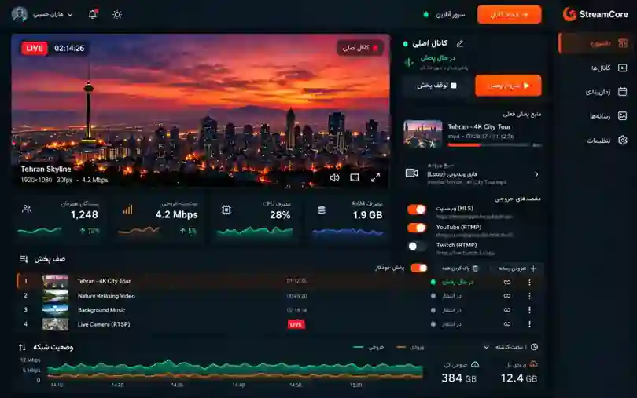
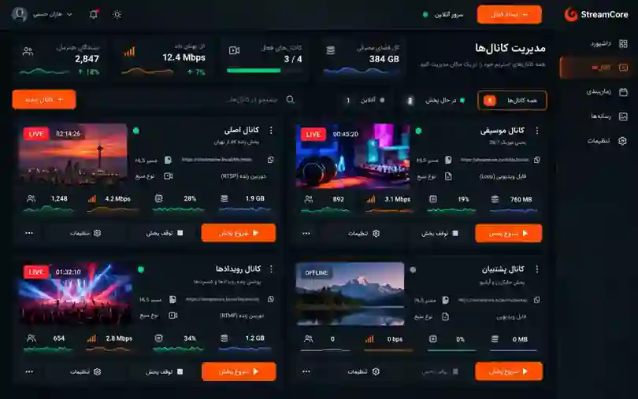
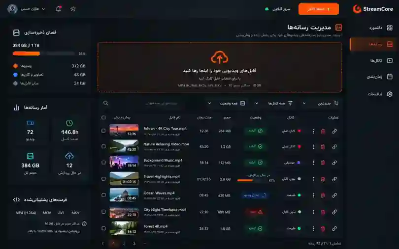
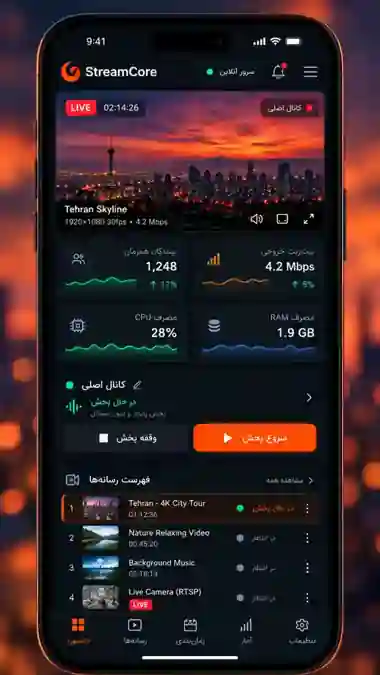

<div align="center">

# 🔴 StreamCore

### Your own 24/7 live streaming control center — entirely on a VPS.

**Stream once. Run continuously. Manage from anywhere.**

[](https://github.com/hazhanhasani/obs-)
[](https://github.com/hazhanhasani/obs-)
[](https://github.com/hazhanhasani/obs-)

**[Installation](#-quick-start)** · **[Architecture](#-architecture)** · **[Screenshots](#-design-preview)** · **[Roadmap](#-roadmap)**

</div>

---

## ✨ Design preview

> **Concept designs — not screenshots from a tested deployment.** Some controls, counters, and features shown here are illustrative and are not yet available in the v0.3.0 alpha. These images show the approved design direction.

<div align="center">



*Live monitoring, stream control, HLS preview, and a dark Persian RTL dashboard.*

<table>
  <tr>
    <td width="50%"></td>
    <td width="50%"></td>
  </tr>
  <tr>
    <th>Channel Management</th>
    <th>Media Library</th>
  </tr>
</table>



*Mobile-first control — the broadcast itself continues on the VPS.*

</div>

## ⚡ Why StreamCore?

Unlike a traditional desktop-based streaming setup, **StreamCore runs its media pipeline on your own Linux VPS**. Your computer and phone do not need to stay online. The browser is only used to configure and monitor your streams.

| Capability | v0.3.0 alpha |
|:--|:--|
| Server-generated live test broadcast | ✅ Implemented |
| Upload H.264 files to VPS | ✅ Implemented |
| Loop a single selected video | ✅ Implemented |
| Multi-channel create/start/stop (up to 8 configured channels) | ✅ Implemented |
| Authenticated RTL dashboard | ✅ Implemented |
| HLS browser delivery via Caddy | ✅ Implemented |
| Recover desired streams after container restart | ✅ Implemented |
| Timed playlists and automatic scheduling | 🛠️ Planned |
| RTMP/RTMPS outbound multistream to Telegram, Instagram, Aparat, YouTube, Twitch, custom | ✅ Implemented (alpha, keys required) |
| External live input URL ingest | 🛠️ Planned |
| Viewer analytics and advanced graphs | 🛠️ Planned |
| Protected paid/private HLS | 🛠️ Planned |

## 📡 Multistream: live on multiple platforms

Send the same VPS-hosted channel to **Telegram, Instagram, Aparat, YouTube, Twitch**, and any compatible RTMP/RTMPS endpoint. StreamCore uses independent stream-copy relay processes, so every destination can be toggled separately.

1. In the Persian admin dashboard, choose **پخش چندمقصدی**.
2. Select the source channel and output platform.
3. Obtain the official **Server URL** and **Stream Key** from the destination platform and save the destination.
4. Enable the destination. Confirm the broadcast is accepted and visible in the destination platform's own producer/control interface.

Stream Keys are encrypted in SQLite and never returned in the API. **Process-based output status is not proof that the remote platform has published the live.** Instagram is subject to account eligibility, session-specific credentials, stream-duration limits, and potentially an additional manual **Go Live** step. Every output currently receives the same H.264/AAC source without platform-specific resizing, vertical conversion, or transcoding. Read the [Multistream Guide](docs/MULTISTREAM.md) for precise steps and limitations.

## 🧱 Architecture

```text
                       Ubuntu VPS
┌────────────────────────────────────────────────┐
│  Admin browser → Caddy HTTPS → FastAPI Panel    │
│                                  ↓              │
│                        SQLite + FFmpeg           │
│                                  ↓              │
│                          RTMP (private)          │
│                                  ↓              │
│                              MediaMTX            │
│                                  ↓              │
│                        HLS → Caddy HTTPS         │
└──────────────────────────────────┬─────────────┘
                                   ↓
                            Viewers / Apps
```

**Stack:** FFmpeg · MediaMTX · FastAPI · SQLite · Docker Compose · Caddy · HLS.js

The RTMP publisher and HLS origin ports are kept inside Docker's private bridge. No Docker Socket is exposed to the application.

## 🚀 One-command automatic installation

Run on a clean Ubuntu 22.04+ VPS over SSH. The installer asks for your **domain**, checks its DNS A record, installs Docker/Compose if needed, deploys all StreamCore containers, waits for Caddy's trusted HTTPS certificate, and finally prints the unique **panel URL, username and password**.

```bash
curl -fsSL https://raw.githubusercontent.com/hazhanhasani/obs-/main/install.sh | sudo bash
```

**Before running:** point your domain's DNS A record at your VPS's public IPv4, disable proxying (e.g. set Cloudflare to DNS-only during certificate issuance), and allow public TCP 80/443. Invalid IPv6 AAAA records should be fixed or removed. **Run this only after reviewing [install.sh](install.sh)**, since a remote shell installer executes as root.

The installation lives at `/opt/streamcore`. Credentials are securely generated using OpenSSL and saved in a root-readable `.env` with mode `600`. Re-running the installer preserves existing login and encryption secrets and updates the checkout; it does not discard existing stream keys or uploaded video data. The installer prints the login details only after HTTPS is validated.

> Production status: this one-command installation is newly implemented and has not yet been verified on a live VPS. The deployment remains an alpha and should not be treated as production-hardened.

## 🚀 Quick start (manual installation)

**Requirements:** Ubuntu 22.04+ VPS, Docker Engine + Compose v2, recommended 2 vCPU / 2 GB RAM for entry-level use, a domain pointed at the server, inbound TCP 80 and 443.

```bash
git clone https://github.com/hazhanhasani/obs-.git
cd obs-
cp .env.example .env

# Generate and enter independent, strong secrets in .env
openssl rand -hex 24 # ADMIN_PASSWORD
# ADMIN_USERNAME defaults to admin in manual installations
openssl rand -hex 32 # SESSION_SECRET
nano .env           # STREAM_DOMAIN=stream.example.com

docker compose up -d --build
docker compose ps
```

Once DNS and HTTPS are ready, open your domain, log in, select your main channel, and start the server-generated test broadcast. Play it at:

```text
https://stream.example.com/live/main/index.m3u8
```

For full configuration and safety notes, see the [deployment guide](docs/DEPLOYMENT.md).

## 🔐 Security and limitations

- The admin panel uses a username, signed session cookies and CSRF checks, but this **alpha has not undergone a security audit**.
- Keep `SESSION_SECRET` stable to decrypt destination keys after updates. FFmpeg's runtime process arguments are visible to privileged users on the VPS.
- Stream playback is **public** in this version; do not upload private or paid content without access controls.
- Uploaded files must contain H.264 video. Video encoding/transcoding during broadcast is not automatic for file sources.
- Actual viewer capacity depends primarily on VPS outbound bandwidth, bitrate, network quality, and whether a CDN is used.
- Current CPU/RAM widgets should **not** be presented as comprehensive host-level telemetry, and the viewer counts in the concept images are illustrative.
- Only distribute media you own or are licensed to stream.

## 🗺️ Roadmap

- [ ] Run full end-to-end Docker/VPS smoke tests and UI visual QA
- [ ] 24/7 playlist scheduler with queue management
- [ ] RTSP, RTMP and SRT ingest with authorized source management
- [x] RTMP/RTMPS multi-destination output management (alpha)
- [ ] Per-destination encoding presets, reliability telemetry, and verified platform health
- [ ] Private viewer links, signed URLs and access policies
- [ ] Accurate bitrate, traffic, concurrent viewer and service telemetry
- [ ] Admin roles, event logs, backup and zero-downtime update workflow

## 📜 License and status

**Development status:** v0.3.0 alpha — not yet validated for production deployment. No open-source license has been granted for this repository. All rights reserved unless a license is added.

<div align="center">

Built for independent, always-on live broadcasting. 🚀

</div>