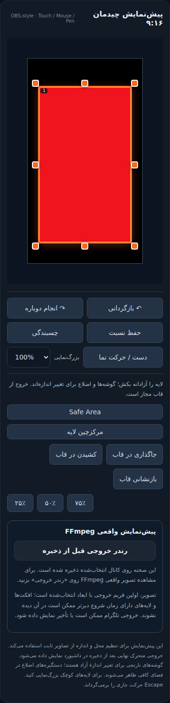

# OBS-inspired editor: implementation and boundaries

This is an original browser implementation inspired by OBS Studio's scene
editing architecture. No C++ or GPL implementation was copied. The reference
was pinned to [OBS Studio f1c0a116](https://github.com/obsproject/obs-studio/tree/f1c0a116441bdb7a1de7896f810009ea487b8508).
It is not a claim of full native OBS parity or Android device certification.

## Source findings and corresponding implementation

| OBS source | Observed pattern | StreamCore implementation |
| --- | --- | --- |
| [OBSBasicPreview.cpp](https://github.com/obsproject/obs-studio/blob/f1c0a116441bdb7a1de7896f810009ea487b8508/frontend/widgets/OBSBasicPreview.cpp), `GetMouseEventPos`, `FindHandleAtPos` | Map display coordinates and pick selected handles geometrically before sources | `scene-transform.js` pure hitTest/handleRects; displayed canvas rectangle; native touch buttons retained |
| Same file, `GetStretchHandleData`, `StretchItem` | Initial transform plus moving edges, opposite anchor, conditional aspect preservation | Eight handles, initial gesture snapshot, optional aspect lock; free resize defaults |
| Same file, `MoveItems`, `SnapItemMovement` | Optional display-scale snapping; frame edge is not a confinement boundary | Six-CSS-pixel snap tolerance, source/frame edges and centers, guide lines, Ctrl/Command bypass |
| Same file, mouse press/release and overflow rendering | Stable gesture lifecycle, before/after snapshots, off-frame editing | Persistent capture root/window continuation, rAF paint, one history entry per gesture, off-frame model |
| [OBSBasicTransform.cpp](https://github.com/obsproject/obs-studio/blob/f1c0a116441bdb7a1de7896f810009ea487b8508/frontend/dialogs/OBSBasicTransform.cpp) | Numeric controls read/write the same scene model without feedback loops | Numeric properties, drag feedback, fit/stretch/center/default-box commands |
| [undo_stack.cpp](https://github.com/obsproject/obs-studio/blob/f1c0a116441bdb7a1de7896f810009ea487b8508/frontend/utility/undo_stack.cpp) | Before/after history, clear redo on new edits | Bounded 100-transaction snapshots; text input grouping; local undo/redo |
| [obs-scene.c](https://github.com/obsproject/obs-studio/blob/f1c0a116441bdb7a1de7896f810009ea487b8508/libobs/obs-scene.c) | Source model controls visibility, locking, transforms and ordering | Additive locked/visible/z_index columns; shared media/text stack in DOM and FFmpeg |
| [OBSBasic_StudioMode.cpp](https://github.com/obsproject/obs-studio/blob/f1c0a116441bdb7a1de7896f810009ea487b8508/frontend/widgets/OBSBasic_StudioMode.cpp) | Distinct preview and program scenes with transitions | Draft preview is separate, but publishing still restarts the compositor; seamless transitions are not implemented |

OBS's desktop selection radius is not a mobile target specification. Four
outward 44px targets are kept for tiny sources. Mid-edge targets are omitted
when their displayed side is shorter than 88px; zoom makes them available.
Hidden and locked sources are excluded from geometric picking. Media opacity,
stacking and animations never move the selected control plane below sources.

## Persistence and compatibility

- Old scenes default to visible/unlocked with null z_index. Null ordering keeps
  the existing media-then-text sequence. Stable sorting resolves tied indexes.
- Reordering assigns a common index across source kinds. New sources are placed
  above existing ones. Per-kind layer_order remains for older consumers.
- Migrations add columns only, are idempotent, and do not rewrite geometry,
  channel modes, output presets, credentials or destinations at startup.
- All source properties are checked against the save response. Draft edits made
  during an in-flight save remain unsaved until explicitly saved again.

## Remaining boundaries

This editor supports axis-aligned boxes. Rotation, arbitrary crop, source
flips, groups, multi-selection, multi-source transforms, native display/game
capture, plugin loading and seamless live transitions are not implemented.
Reset box means the web editor's default bounding dimensions, not native source
pixels. Snapping during aspect-locked resize is disabled so it cannot distort
the ratio. The explicit Hand tool pans with mouse/pen and enables native touch scrolling.
Zoom/pan are workspace navigation, not video transforms.

Static browser text is approximate; the FFmpeg preview is authoritative.
Storage remains normalized with 0.1% editing precision and bounded resource
limits. This is an alpha release despite the additional interaction coverage.
Physical Android/Chrome or WebView checks require a connected device and remain
separate from desktop Chromium's mobile viewport/contact simulation.

## Verification

- `tests/test_scene_transform.cjs`: anchors, aspect preservation, hit regions,
  snapping and history semantics.
- `tests/test_scene_obs_model.py`: additive migration, metadata persistence,
  mixed FFmpeg source order, hidden sources and duplicate IDs.
- `tests/test_scene_interactions.cjs`: actual browser input under production
  CSP/authentication; desktop and 360/390/430px mobile viewports; finite finger
  contact and DPR; history, Escape, keyboard, zoom, visibility/locking and actual
  decoded FFmpeg pixels. Existing save/reload and four-output-preset gates stay.

No live installation is restarted by these tests. They run an isolated SQLite
application instance with publishing supervisors disabled.

## Recorded browser evidence

[390px touch-input recording](screenshots/obs-editor-mobile-0.9.0.webm)
shows a real Chromium gesture on the north edge, undo/redo, save and reload.
It is desktop Chromium emulating touch, not a recording from physical Android.

Final local verification: 120 browser input cases; 57 JavaScript cases; 68
Python tests plus 27 subtests; 2 independent Chromium hitbox cases. Installer,
syntax and diff checks passed. A prior local run timed out on the numeric
aspect save case; after adding response/settlement diagnostics, the isolated
case and the complete 120-case rerun passed. The timeout was not reproduced.
CI independently rechecks the published tree, including the Docker image.
